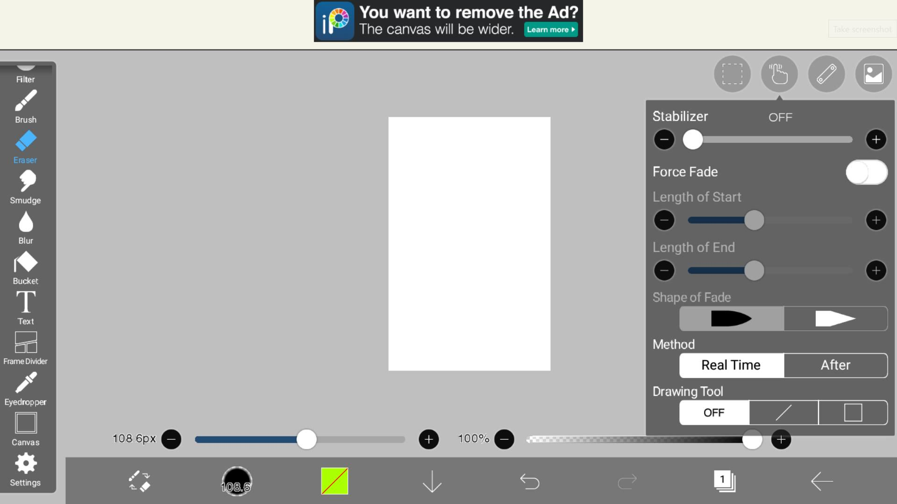
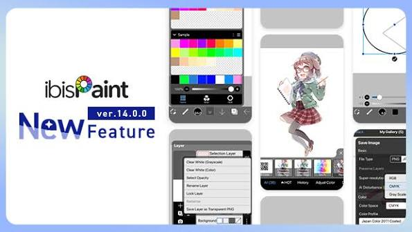

# ibisPaint: Sketches, Color, and Moving Drawings

A character illustration usually passes through rough shapes, clean contours, flat colors, and lighting before it is ready to share.
ibisPaint brings those stages into a drawing workspace with brushes, layers, selection tools, manga features, and animation.

## Decide What the Finished Drawing Needs

A profile picture needs a readable silhouette at small sizes; a comic panel needs clear lettering and deliberate spacing.
A transparent character cutout also needs clean edges when placed over a different background.

- Set canvas dimensions around the intended display or print requirements.
- Keep a working artwork with its layers intact while preparing separate delivery copies.
- Test a few strokes at the intended brush size before committing to the final linework.

[](https://ibis-paint-pro.github.io/Ibis-Paint-X/)

## Move from a Rough Pose to Clean Contours

Lower the sketch layer's opacity and draw the finished contours on another layer.
Adjust stabilization to the stroke you are making: a slow curve and a quick expressive mark may need different settings.

### Build a Brush Set Around the Picture

A firm pen can define silhouettes, while a softer brush can establish broad lighting.
For an ibis paint drawing, judge a brush by its edge, opacity, and response at the size you actually use.

- Draw long contours in comfortable motions, rotating the canvas when needed.
- Use symmetry rulers for suitable designs, then inspect the result for unwanted mechanical repetition.
- Try a custom brush on a spare layer before using it across an entire illustration.



## Keep Color Changes Local

Separate major color regions so that changing clothing does not require repainting the face.
Clipping lets a shading layer follow the painted area beneath it, making controlled color experiments easier.
The [official clipping lesson](https://ibispaint.com/lecture/index.jsp?no=30) shows this relationship in the layer window.

| Painting decision | Useful layer arrangement | Effect on later revisions |
| --- | --- | --- |
| Change a character's clothing | Clothing base separate from skin and hair | Color edits stay within one component |
| Try stronger lighting | Shadows and highlights on separate layers | Intensity can be adjusted independently |
| Add fabric texture | Texture clipped above the clothing base | Marks follow the underlying painted area |
| Compare background ideas | Background separate from the character | Composition can change without repainting the subject |
| Prepare a cutout | Character isolated from opaque backgrounds | Transparency can be checked before export |

Before merging layers, ask whether the next revision might require their separate contents.

## Give Panels and Frames a Clear Rhythm

Manga pages benefit from decisions about reading order before decorative work begins.
Use frame division, text, and screen tones to support the action and leave enough space for dialogue.

For moving drawings, start with a short action that has a clear beginning and end.
Place the main poses first, then add intermediate frames to control timing.
Onion skinning displays neighboring frames as references while you adjust the current drawing.



A drawing-process video serves a different purpose: it shows how the artwork developed.
Use it to explain decisions or review your own approach without replacing the editable artwork.

## Choose the Version Around Your Device

People searching for ibis paint pro may mean a desktop Pro Upgrade, Premium Membership, or simply an ad-free experience.
On mobile, ibis paint x is the free, ad-supported edition; removing advertisements and subscribing to premium features are different choices.
The phrase ibis paint x pro also appears in searches, but check the exact product label and entitlement shown for your platform.
Features, purchase options, and prices should be checked in the [official product pages](https://ibispaint.com/product.jsp) and the app's purchase screen.

ibisPaint has Windows, Mac, iPhone/iPad, and Android versions.
If you are looking for ibis paint online or ibis paint web, distinguish the website's gallery and tutorials from the installed drawing application.
Use the official platform information to confirm the version suited to your device.

## Make Delivery Copies without Losing the Working Artwork

Keep the layered working artwork before making flattened copies.
Choose PNG when you need transparency or crisp image details, and JPEG when an opaque compressed image is appropriate.
When sharing editable work through PSD, export from My Gallery with layer preservation enabled and inspect the result in the receiving application.
The [export lesson](https://ibispaint.com/lecture/index.jsp?lang=en&no=206) explains which options depend on the format and export location.

### Resize a Separate Preview

After exporting a PNG from ibisPaint, ImageMagick can prepare a smaller copy.
With ImageMagick 7 available in PowerShell, this limits the preview to a 1600-by-1600 bounding box without enlarging a smaller image:

```powershell
# Replace the example input with your exported PNG.
$artwork = "character-export.png"
magick $artwork -resize "1600x1600>" "character-preview.png"
```

Open the preview at its intended display size and check line weight, lettering, and transparency.

### Create Web Copies from Several Exports

This PowerShell example uses ImageMagick to convert PNG exports in the current directory into separate WebP files.
Run it in a directory containing only the images you intend to convert:

```powershell
Get-ChildItem -File -Filter "*.png" | ForEach-Object {
    $webCopy = Join-Path $_.DirectoryName ($_.BaseName + "-web.webp")
    magick $_.FullName -quality 85 $webCopy
}
```

Review compression around small text, gradients, and transparent edges before publishing.
These commands use [ImageMagick's documented command syntax](https://imagemagick.org/command-line-processing/).

## Read the Accompanying Comparison Material

The accompanying files are a partial Krita source selection supplied as comparison material, rather than ibisPaint source code.
They contain build configuration, packaging tools, and test support; this subset alone does not establish a complete buildable Krita checkout.

### Platform and Packaging References

- [CMakeLists.txt](CMakeLists.txt) defines the Krita project and build options.
- [windows.yml](build-tools/ci-scripts/windows.yml) and [linux.yml](build-tools/ci-scripts/linux.yml) define platform CI settings.
- [macos.yml](build-tools/ci-scripts/macos.yml) and [android.yml](build-tools/ci-scripts/android.yml) cover the other supplied platform configurations.
- [build-windows-package.py](build-tools/ci-scripts/build-windows-package.py) handles Windows packaging.
- [build-android-package.py](build-tools/ci-scripts/build-android-package.py) and [build-android-appbundle.py](build-tools/ci-scripts/build-android-appbundle.py) handle Android package formats.
- [build-appimage.py](build-tools/ci-scripts/build-appimage.py) supports AppImage packaging.
- [README.md](build-tools/docker/README.md) points to the relocated Krita Docker environment.
- [AUTHORS](AUTHORS) identifies the maintainer and points to further attribution.

### Optional Components and Generated Configuration

- [CMakeLists.txt](3rdparty_plugins/CMakeLists.txt) coordinates external plugin builds.
- [CMakeLists.txt](3rdparty_plugins/ext_gmic/CMakeLists.txt) configures the external G'MIC component.
- [build-plugins.py](build-tools/ci-scripts/build-plugins.py) controls plugin build handling in CI.
- [config_convolution.h.cmake](config_convolution.h.cmake) contains the FFTW3 availability definition.
- [config-android-stdio-forwarding.h.cmake](config-android-stdio-forwarding.h.cmake) defines the Android standard-stream forwarding switch.
- [config_qt5_has_wintab_switch.h.cmake](config_qt5_has_wintab_switch.h.cmake) contains a Qt5 Wintab capability definition.

### Python Test Support and Shared Headers

- [dev-requirements.txt](dev-tools/python/dev-requirements.txt) lists pinned Python development dependencies.
- [setup.py](dev-tools/python/krita-mock/setup.py) packages the Krita mock module.
- [__init__.py](dev-tools/python/krita-mock/src/krita/__init__.py) supplies mock attributes for unit tests.
- [kis_global_pch.h](pch/kis_global_pch.h) collects global precompiled-header includes.
- [kis_image_pch.h](pch/kis_image_pch.h) collects image-related includes.
- [kis_global_test_pch.h](pch/kis_global_test_pch.h) and [kis_image_test_pch.h](pch/kis_image_test_pch.h) extend those headers for tests.

## Related Search Terms

ibis paint pro, ibis paint x, ibis paint x pro, ibis paint online, ibis paint web, art, brushes, creative, drawing, graphics-tablet, painting, animation, bitmap, cartoon, onion-skin
